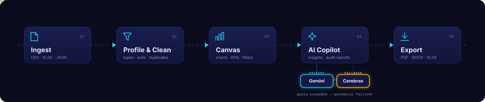
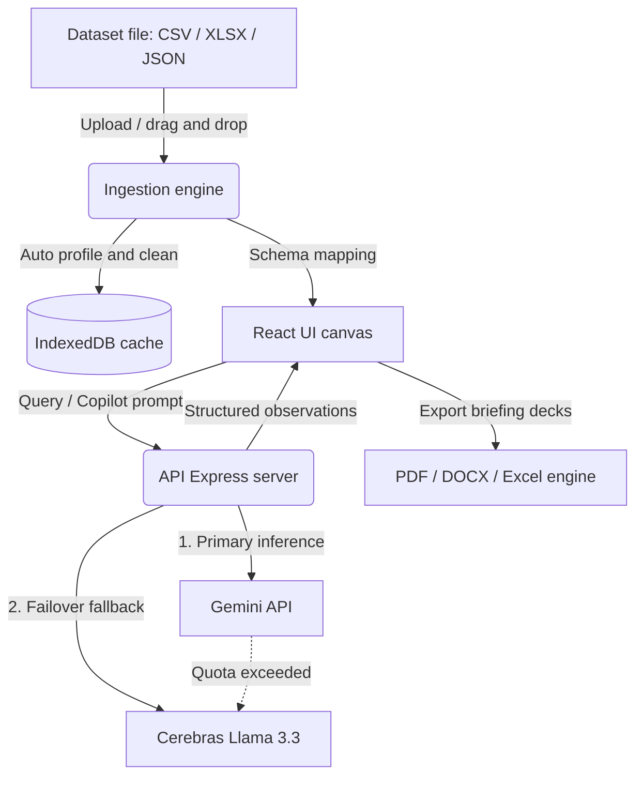

<div align="center">



<br />

<a href="https://github.com/26Utkarsh/insightflow/stargazers"></a>
<a href="https://github.com/26Utkarsh/insightflow/network/members"></a>
<a href="https://github.com/26Utkarsh/insightflow/blob/main/LICENSE"></a>

<br /><br />


<br /><br />

<b>A premium AI-powered business intelligence workspace for instant dataset profiling,<br />audit compliance, and interactive visual reporting.</b>

<br /><br />

<a href="#what-it-does">What it does</a> &nbsp;·&nbsp;
<a href="#how-data-flows">How data flows</a> &nbsp;·&nbsp;
<a href="#features">Features</a> &nbsp;·&nbsp;
<a href="#tech-stack">Tech stack</a> &nbsp;·&nbsp;
<a href="#quickstart">Quickstart</a>

</div>


## What it does

Three moves, from raw file to finished brief.

<table>
<tr>
<td width="33%" valign="top">

### 01 &nbsp;Ingest

Drag and drop **CSV, Excel, or JSON**. InsightFlow runs schema profiling, handles missing values, removes duplicates, and standardises formats instantly.

</td>
<td width="33%" valign="top">

### 02 &nbsp;Explore

Work in an interactive canvas with **dynamic charts**, customisable dimensions, and real-time filtering, powered by Recharts.

</td>
<td width="33%" valign="top">

### 03 &nbsp;Ask

Get deep contextual observations from the **AI Copilot**. A dual-engine LLM structure (Gemini, with Cerebras as fallback) keeps synthesis, audit reports, and summaries flowing without interruption.

</td>
</tr>
</table>

<div align="center">



<sub>An illustration of the canvas, drawn for this README. It is not a live screenshot.</sub>

</div>


## How data flows



<br />

<details>
<summary><b>System architecture and data flow (click to expand)</b></summary>

<br />



</details>


## Features

| | Feature | What you get |
| :-: | :-- | :-- |
| ⚡ | **Dual AI engine** | Primary inference via Gemini with automatic failover to Cerebras Llama 3.3 for high availability. |
| 🧹 | **Auto data cleaning** | Detects and resolves missing records, anomalous numbers, and duplicate stamps during ingestion. |
| 🎨 | **Bespoke UI** | Premium light-first styling by default, ambient botanical line-art backgrounds, Satoshi typography, and fluid transitions. |
| 📁 | **Local-first storage** | Client history and active catalogs persisted in IndexedDB for maximum speed and security. |
| 📈 | **Rich visual charts** | Interactive metrics rendered with responsive Recharts, grouped by custom dimensions. |
| 🖨️ | **Print-ready briefs** | Export professional PDFs, Excel sheets, and print layouts with one-click operations. |


## Tech stack

<div align="center">


</div>

<br />

| Layer | Choice |
| :-- | :-- |
| **Core** | React 18 · TypeScript · Vite · Tailwind CSS v4 |
| **State** | Zustand with local IndexedDB persistence |
| **Visualisation** | Responsive Recharts graphs |
| **Inference** | Google Gemini (primary) · Cerebras Llama 3.3 (fallback) |
| **Export** | ExcelJS · jsPDF · DOCX export · html2canvas |


## Quickstart

### Local installation

```bash
# Clone the repository
git clone https://github.com/26Utkarsh/insightflow.git
cd insightflow

# Install node dependencies
npm install

# Start local server and frontend watch
npm run dev
```

Open `http://localhost:3000` and drop in a dataset.

### Environment configuration

Create a local `.env` file at the root of the project:

```bash
# Primary AI API (required)
GEMINI_API_KEY=your_gemini_api_key_here
GEMINI_MODEL=gemini-3.5-flash

# Fallback AI API (optional)
CEREBRAS_API_KEY=your_cerebras_api_key_here
CEREBRAS_MODEL=llama-3.3-70b
```

> [!TIP]
> Keep `.env` out of version control. Add it to your `.gitignore` so your API keys never reach GitHub.

<br />

<div align="center">


**Built by [Utkarsh](https://github.com/26Utkarsh)**

If InsightFlow saved you an afternoon, a ⭐ keeps the signal strong.

<a href="https://github.com/26Utkarsh/insightflow"></a>

</div>
